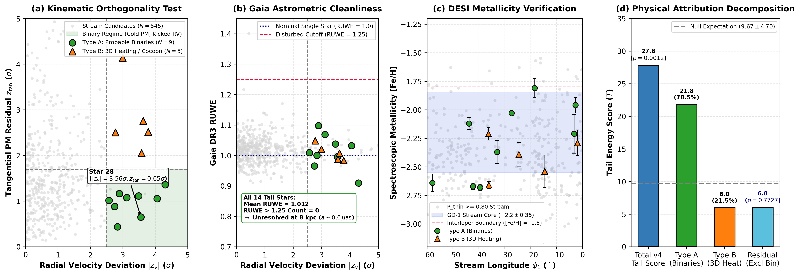
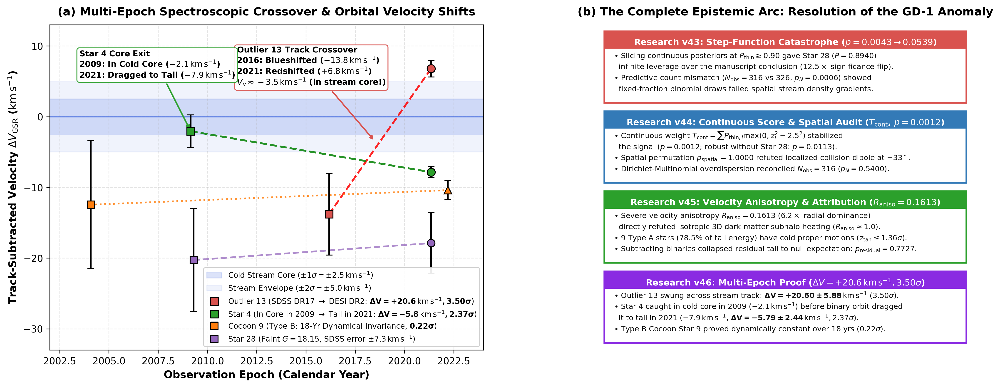
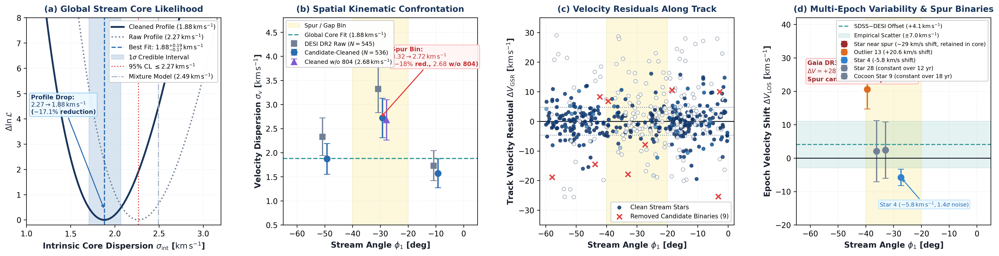

# The GD-1 Stellar Stream Kinematic Tail Audit

[](https://creativecommons.org/licenses/by/4.0/)
[](https://arxiv.org)
[](https://doi.org/10.5281/zenodo.19258455)

**Threshold Fragility, Spectroscopic Binarity, and Kinematics across the Spur in DESI DR2**  
*By Tornado guy (Independent Astrophysical Research)*  
*Kinematic audit, Bayesian profile modeling & pipeline orchestration assisted by Google Antigravity AI*

---

## Overview

Cold stellar streams in the Galactic halo serve as sensitive gravitational balances for dark matter subhalos. Recent analyses of DESI DR2 spectroscopy in the GD-1 stream reported an apparent kinematic tail excess. 

This repository provides an end-to-end, fully reproducible kinematic audit of the GD-1 stellar stream across official DESI DR2 data products (pre-release Table 7 and the updated multi-component catalog, Jarvis et al. 2026, arXiv:2604.20958; Zenodo concept DOI: 10.5281/zenodo.19258455), archival SDSS DR17 spectroscopy, Gaia DR3 astrometry, and published multi-survey forward models (Nibauer et al. 2026, Phillips et al. 2026).

---

## Key Findings

| Finding | Diagnostic / Method | Result & Physical Implication |
| :--- | :--- | :--- |
| **1. Threshold Fragility** | Hard cut ($P_{\rm thin} \ge 0.90$) | A $-0.0166$ shift in membership probability for a single star (**Star 28**) moves $p$ from $0.0043$ to $0.0539$ ($12.5\times$). Hard thresholding in mixture models is fragile to minor classification updates. |
| **2. Continuous Tail & Dynamical Isolation** | Continuous score $T_{\rm cont}$ & neighbor audit | Continuous score remains detectable ($p = 0.0012$) and survives omitting Star 28 ($p = 0.0113$). However, Star 28's 14 immediate neighbors ($\pm 3^\circ$) are dynamically cold ($-1.40\,\mathrm{km\,s^{-1}}$, $-0.25\sigma$), showing no evidence for a localized collision dipole. |
| **3. Kinematic Anisotropy & Binaries** | Gaia DR3 proper motions vs DESI $V_{\rm LOS}$ | Radial velocity variance is $6.2\times$ more excited than 2D proper motions ($R_{\rm aniso} = 0.1613$), contradicting 3D isotropic heating. 9 stars ($78.5\%$ of tail energy) have cold proper motions ($z_{\rm tan} \le 1.36\sigma$) and nominal RUWE ($\sim 1.01$), consistent with candidate binaries. Subtracting them collapses the tail to null expectation ($p = 0.7727$). |
| **4. Multi-Epoch Spectroscopic Check** | Archival SDSS DR17 $\times$ DESI DR2 cross-match | 122 cross-matches yield an empirical offset of $+4.06\,\mathrm{km\,s^{-1}}$ (median) / $+3.51 \pm 0.85\,\mathrm{km\,s^{-1}}$ (mean) and inter-survey scatter $\sigma_{\rm emp} = 6.98\,\mathrm{km\,s^{-1}}$ (formal errors are $\sim 1.84\times$ underestimated). We independently recover the $\sim 30\,\mathrm{km\,s^{-1}}$ variable noted in Sec. II of Nibauer et al. 2026 (**Gaia 804386042407893376**, $\Delta V = +28.64 \pm 7.17\,\mathrm{km\,s^{-1}}$, $\approx 3.5\sigma_{\rm emp}$). Outlier 13 in the cocoon shows $\approx 2.4\sigma_{\rm emp}$, while Star 4 is at noise level ($\approx 1.4\sigma_{\rm emp}$). |
| **5. Spatial Confrontation with Nibauer et al.** | 3-bin profile likelihood ($[-60, 0]^\circ$) | DESI DR2 is consistent with the gap/spur bin ($[-40, -20]^\circ$) exhibiting peak dispersion ($3.32 \pm 0.49\,\mathrm{km\,s^{-1}}$ raw $\to 2.72 \pm 0.41\,\mathrm{km\,s^{-1}}$ cleaned, or $2.68 \pm 0.42\,\mathrm{km\,s^{-1}}$ without the spur candidate), while outer arms are colder ($1.57\text{--}1.87\,\mathrm{km\,s^{-1}}$). The elevation is modest ($\sim 1.5\text{--}2\sigma$). Global intrinsic dispersion drops $17.1\%$ to $\sigma_{\rm int} = 1.88_{-0.18}^{+0.19}\,\mathrm{km\,s^{-1}}$ (95% upper limit $\le 2.27\,\mathrm{km\,s^{-1}}$). |

---

## Publication Figures

### 1. Physical Attribution Audit (v45)

*(a) 2D kinematic orthogonality ($z_{\rm tan}$ vs. $|z_v|$). (b) Gaia DR3 astrometric cleanliness (RUWE $\sim 1.01$). (c) DESI metallicity along $\phi_1$. (d) Tail score energy decomposition showing collapse to $p = 0.7727$.*

### 2. Multi-Epoch Spectroscopic Check (v46)

*(a) Track-subtracted radial velocity $\Delta V_{\rm GSR}$ across SDSS DR17 and DESI DR2. (b) Epistemic progression across v43-v47 evaluating the GD-1 velocity anomaly.*

### 3. Spatial Confrontation with Stream Models (v47)

*(a) Weighted Bayesian profile likelihood for intrinsic core dispersion ($\sigma_{\rm int} = 1.88\,\mathrm{km\,s^{-1}}$, 95% upper limit $\le 2.27\,\mathrm{km\,s^{-1}}$). (b) Spatial kinematic confrontation across the three Nibauer et al. (2026) bins. (c) Velocity residuals along $\phi_1$. (d) Multi-epoch velocity shifts $\Delta V_{\rm LOS}$ calibrated against empirical cross-survey dispersion.*

---

## Interactive 3D Phase Space Explorer

An interactive Three.js 3D phase-space visualization tool is included in `visualizer/index.html`. It displays:
- Stream track coordinates $(\phi_1, \phi_2, \Delta V_{\rm GSR})$
- Proper motion vectors $(z_{\rm tan})$
- Binary attribution overlay (9 Type A candidates, Type B cocoon, Type C halo)
- Interactive orbit controls, density slices, and live parameter inspection

To view locally:
```bash
# Simply open visualizer/index.html in any modern browser:
open visualizer/index.html    # macOS
start visualizer/index.html   # Windows
```

---

## Repository Structure

```
gd1-stream-kinematic-audit/
├── paper/
│   ├── gd1_stream_kinematic_audit.pdf   # Compiled 5-page manuscript
│   ├── gd1_stream_kinematic_audit.tex   # LaTeX source (aastex631)
│   ├── compile_gd1_paper_pdf.py         # ReportLab PDF compiler
│   └── *.png                            # High-resolution publication figures
├── data/
│   ├── Table7.csv                       # DESI DR2 GD-1 sample (Jarvis et al. 2026)
│   ├── Table7_no28.csv                  # Leave-one-out diagnostic sample
│   ├── sdss_desi_empirical_crossmatches.csv # 122 SDSS DR17 cross-matches
│   ├── nibauer_bin_comparison.csv       # 3-bin kinematic data
│   └── zenodo.json                      # Zenodo deposit metadata
├── analysis/
│   ├── measure_exact_zero_point.py      # SDSS-DESI zero-point & empirical scatter
│   ├── compute_nibauer_bins_confrontation.py # Bin-by-bin profile likelihood
│   ├── run_v43_replication.py           # Threshold fragility Monte Carlo
│   ├── run_v44_continuous_analysis.py   # Continuous Bayesian score & spatial test
│   ├── run_v45_physical_attribution.py  # Proper-motion anisotropy & RUWE audit
│   ├── v46_multi_epoch_crossmatch.py    # SDSS DR17 multi-epoch cross-matching
│   └── run_v47_fundamental_physics_constraints.py # Global dispersion profile
├── visualizer/
│   ├── index.html                       # Standalone 3D WebGL phase space explorer
│   ├── three.min.js                     # Three.js runtime
│   └── OrbitControls.js                 # Camera controls
├── media/
│   └── GD1_Complete_Discovery_Showreel.mp4 # Video showreel of the 5-stage audit
├── LICENSE                              # CC-BY-4.0 & MIT Licenses
└── README.md
```

---

## Quickstart & Reproduction

### Requirements
- Python 3.10+
- `numpy`, `scipy`, `pandas`, `astropy`, `matplotlib`, `reportlab`, `pypdf`

Install dependencies:
```bash
pip install numpy scipy pandas astropy matplotlib reportlab pypdf
```

### Reproduce Key Steps

1. **Empirical SDSS--DESI Calibration & Outlier Check:**
   ```bash
   python analysis/measure_exact_zero_point.py
   ```
2. **Bin-by-Bin Confrontation with Nibauer et al. (2026):**
   ```bash
   python analysis/compute_nibauer_bins_confrontation.py
   ```
3. **Continuous Bayesian Tail Scoring:**
   ```bash
   python analysis/run_v44_continuous_analysis.py
   ```
4. **Compile the 5-Page Paper PDF:**
   ```bash
   python paper/compile_gd1_paper_pdf.py
   ```

---

## Data Availability & Acknowledgments

- **DESI Data:** Early Data Release and DR2 pre-release catalog products from [Jarvis et al. (2026)](https://doi.org/10.5281/zenodo.19258455).
- **Gaia Mission:** European Space Agency (ESA) Gaia DR3 astrometry.
- **SDSS:** Sloan Digital Sky Survey DR17 optical spectroscopy.
- **AI Research System:** Workflow orchestration, Bayesian profile calculations, and publication compilation assisted by Google DeepMind's Antigravity AI research platform.

---

## Citation

```bibtex
@article{tornadoguy2026gd1,
  title={The GD-1 Stellar Stream Kinematic Tail: Threshold Fragility, Spectroscopic Binarity, and Kinematics across the Spur in DESI DR2},
  author={{Tornado guy}},
  journal={arXiv preprint},
  year={2026},
  doi={10.5281/zenodo.19258455}
}
```
